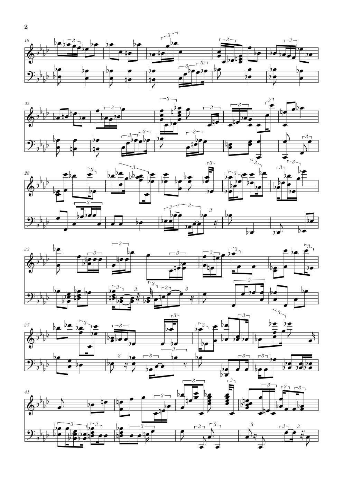

# music_to_playable_piano_score

## 起因

由于网上很难找到一些相对小众的乐曲的钢琴改编，我就想到了尝试 vibecoding 一个好用的工具出来顺便分享一下。可是我没想到的是，我很难找到一个现成的开源模型拿来做一些整合包之类的，那我只能退而求其次，继续调研一些合适的工具。这时问题来了，耦合进来的东西越多，贪吃的蓝色大肥鱼 deepseek 就越干不明白这个工作，好几次把工作区搞的像亚空间一样。而且大肥鱼是真的吃白饭啊，卡死，死循环，大战 powershell 等情况一直在发生，不知道浪费了我多少 token。还有，由于我这个国庆假期过糊涂了而且我 8 号这一天没课，我还以为 8 号是梁文谷时段！一天跑了我 40 多块钱！还有就是，似乎真的没有能很好的转换钢琴谱面的工具，我指的不是单纯的音频转 midi，而是把一首曲子在忠实于原曲的情况下改编的可弹，然后我发现这里的问题多了去了。详见下方 readme。最后我只能把几个开源项目拼一拼，拼出一个稍微能用的东西，各位大哥大姐赏脸给个 star 吧。

---

**音频 → 可弹的钢琴谱。** 一条从 MP3 走到 MusicXML / MIDI / PDF 的完整管线，
目标不是"转谱最准"，而是**产出一份人能直接拿去改、并且弹得动的钢琴谱**。

输入一首混音成品（人声 + 伴奏 + 鼓），输出两行谱：右手主旋律、左手伴奏，
带拍号、调号、速度标记、可演奏的跨度约束，外加一份可核对的验收报告。

> 这是一个**个人实验项目**，不是产品。它的定位很具体：
> **给人工制谱当前期参考**。四首样例的 PDF 可以直接打开看效果，
> 但请按"能用的草稿"而不是"成品谱"来期待。

[](https://github.com/MoveBricksWorker/music_to_playable_piano_score/actions/workflows/verify.yml)

*CI 会对仓库里的四首样例断言那几条硬指标（宽和弦 0、拥挤起音 0、R1 = 0、不丢音、有调号）——见 [tests/](tests/)。*



*上图是仓库里样例的真实输出（[`out/victim/victim.pdf`](out/victim/victim.pdf) 第 2 页），
F 小调 2/4，右手三连音十六分，左手伴奏。可以看到成品仍然偏"花"——
多余临时记号的成因写在[已知缺陷](#已知缺陷--路线图)里。*

---

## 目录

- [它现在做到什么程度](#它现在做到什么程度)
- [快速开始](#快速开始)
- [管线详解](#管线详解)
- [三个关键判据](#三个关键判据)
- [已知缺陷 & 路线图](#已知缺陷--路线图)
- [仓库结构](#仓库结构)
- [许可与第三方](#许可与第三方)

---

## 它现在做到什么程度

四首样例曲全部跑完的**实测**数字（`out/` 里的产物，脚本可复现）：

| 曲目 | 拍号 | 小节 | BPM | 宽和弦 | 拥挤起音 | 最大跨度 | 旋律保留 |
|---|---|---|---|---|---|---|---|
| victim | 2/4 | 149 | 76.9 | **0** | **0** | 19 | **1.000** |
| yoake | 4/4 | 74 | 89.6 | **0** | **0** | 19 | **1.000** |
| collapse | 4/4 | 86 | 77.9 | **0** | **0** | 19 | **1.000** |
| blessing | 3/4 | 212 | 142.9 | **0** | **0** | 19 | **1.000** |

* **宽和弦**＝单手跨度 >19 半音的音（那样的和弦只能滚奏）；**拥挤起音**＝同一时刻 >5 个音。
  这两项是"能不能弹"的硬约束，四首全部达标。
* **旋律保留 1.000** ＝ SheetSage2 抽出来的人声旋律，一个音都没丢，且始终在最高声部。
* 口径：`python -m pipeline.verify_playable --root out`，**在成品 MusicXML 上测**，
  不是在工作文件上测（理由见[谱面才是唯一可信口径](#3-验收以谱面为准不是以编排文件为准)）。

谱面内容完整性（`python tools/check_structure.py`，逐起音把谱面和编排对齐）：

| 曲目 | 调号 | 空小节 / 没填满的小节 | 编排里的起音丢失数 | 跨小节线连音线碎片 |
|---|---|---|---|---|
| victim | −4（F minor） | 0 / 0 | **0** | 151 |
| yoake | −3（E♭ major） | 0 / 0 | **0** | 224 |
| collapse | −4（F minor） | 0 / 0 | **0** | 140 |
| blessing | +1（E minor） | 0 / 0 | **0** | 120 |

"连音线碎片"是"跨小节线的音被切成两段、用连音线连起来"，**不是丢音也不是多击**——
编排里的起音在谱面里一个都没少。

时值形状（用户给的四条判据，`python -m pipeline.check_shapes --root out`）：

| 曲目 | R1 三连音不成组 | R2 组内时值不等 | R3 短-长-短 | R4 相邻时值比 >2 | 最短音长 |
|---|---|---|---|---|---|
| victim | **0** | 89 | 127 | 256 | 65 ms |
| yoake | **0** | 88 | 254 | 315 | 56 ms |
| collapse | **0** | 58 | 148 | 210 | 64 ms |
| blessing | **0** | 22 | 88 | 160 | 35 ms |

**R1 = 0 是这套管线目前最硬的一块**：允许三连音，但只允许**成 3 或 6 个一组、
组内时值相等**地出现，落单的一律回归二分体系。R2/R3/R4 仍未达标，根因见下文。

> 上面这组数字是**修掉三连音判据的密度偏置之后**的结果（见
> [已知缺陷 → 量化器的代价口径](#-量化器的代价口径曾把噪声读成三连音已修)）。
> 修复前后对比：blessing 的 R2 35 → **22**、R3 113 → **88**、R4 200 → **160**。

---

## 快速开始

### 方式 A：用整合包（推荐给"我就想出谱"的人）

整合包是**整个目录的拷贝**：自带 Python 解释器、模型权重、四首输入、以及全部中间产物，
拷到别的机器上**不需要网络、不需要装任何东西**。

```
整合包  下载约 8 GB
├─ python/         自带解释器（约 6.4 GB，含 torch 2.6.0+cu124）
├─ models/         模型权重 570 MB（SheetSage2 + demucs，附 SHA-256 清单）
├─ data/           四首输入 362 MB（MP3 + 分轨 + 转谱 MIDI + SheetSage2 标签）
├─ work/           工作区 530 MB（seed_work.py 从 data/ 铺出来）
└─ out/            成品
```

> **下载**：[夸克网盘](https://pan.quark.cn/s/3bef4e0fd86c?pwd=Wuqn) 　提取码：`Wuqn`
>
> 整合包根目录下有一份 `先读我.txt`，解压后先看它——里面写了**不要用
> `python\Scripts\*.exe`** 这条关键前提，以及出问题时该跑哪个诊断脚本。

```bat
:: 出谱：用自带输入与自带标签，离线，四首约 1 分钟
run.bat

:: 只跑一首
run.bat victim

:: 从音频开始跑（含 Demucs 分离 + Transkun 转谱，需要 NVIDIA GPU）
run.bat victim --from separate

:: 验收
python -m pipeline.verify_playable --root out    :: 能不能弹（跨度 / 同时音）
python -m pipeline.check_shapes   --root out     :: 好不好读（三连音分组 / 时值形状）
python tools/check_structure.py                  :: 内容对不对（调号 / 小节 / 有没有丢音）
python tests/regression.py --verbose             :: 三条硬指标的回归闸门
```

`run.bat` 会自动挑解释器：优先包内的 `python\python.exe`，没有才退回系统 `python`。

> **注意**：请用 `python.exe -m 模块名` 或 `python.exe 脚本.py`，
> **不要**用 `python\Scripts\*.exe`（`pip.exe` / `demucs.exe` 等）。
> 那些启动器把安装时的绝对路径写死在 exe 里，目录一搬就失效；
> `python.exe` 本身和 site-packages 都是按运行位置定位自己的。
> 详见 [docs/PIPELINE_NOTES.md](docs/PIPELINE_NOTES.md#环境为什么不重新装而是直接复制)。

### 方式 B：只用这个仓库（给想读代码 / 改管线的人）

仓库只跟踪**代码、文档与四首成品样例**（约 6 MB）。跑起来需要自己准备依赖与模型：

```bash
git clone <你的仓库地址>
cd music_to_playable_piano_score

# 建环境（会从 PyTorch 官方源装 cu124 版 torch）
python install_env.py --check      # 先看现在缺什么
python install_env.py              # 或 --cpu 装 CPU 版

# 把模型权重搬进 ./models（让它离线可用）
python make_portable.py --source <上游项目根>   # 或设 E2S_SOURCE_REPO
python make_portable.py --check

# 跑
python run_pipeline.py --list-stages
```

缺模型时管线仍可跑**下半程**：`⑤ 编排 → ⑥ 修正 → ⑦ 雕版 → ⑧ 渲染` 这条链路
不需要 GPU、不需要 torch，只用 music21。前提是有：
`work/transkun/<曲>.mid`（转谱结果）、`work/sheetsage2/<曲>/`（节拍/调号/旋律标签）。

```bash
python seed_work.py               # 把 data/ 铺进 work/（整合包里有 data/ 才有用）
python run_pipeline.py --from arrange --to engrave --no-render
```

---

## 管线详解

九个阶段，入口只有 [`run_pipeline.py`](run_pipeline.py) 一个：

```
                 ┌──────────────────────── ① 分离（Demucs，需 GPU）
  audio.mp3 ────►│ htdemucs_6s ──► piano.wav
                 └ htdemucs    ──► other.wav
                        │
                        ▼  ② 相加（float64 相加，仅防削波，不做归一化）
                    sum.wav
                        │
                        ▼  ③ 转谱（Transkun 2.0，复音钢琴转谱，需 GPU）
                 sum_transkun.mid ────────────────┐
                        │                         │
                        │  ④ 节拍/调号/和弦/旋律  │
                        │  （SheetSage2 → .lab） │
                        ▼                         ▼
                  ┌───────────── ⑤ 编排 ─────────────┐
                  │ 12 tick/拍双格量化                │
                  │ 中音 C 分手（≥60 右手，<60 左手）  │
                  │ 删人声串音、旋律强制最高声部       │
                  └───────────────┬──────────────────┘
                                  ▼  编排文本 + 旋律 sidecar（纯文本，可手改）
                          ⑥ 可弹性修正（跨度 ≤19、同时音 ≤5）
                                  ▼
                          ⑦ 雕版（时值规整 → 小节填满 → 按调号拼写）
                                  ▼
                          ⑧ 导出 MusicXML / MIDI / PDF
                                  ▼
                          ⑨ 验收（谱面口径）
```

| 阶段 | 代码 | 做什么 | 关键点 |
|---|---|---|---|
| ① `separate` | [run_pipeline.py:128](run_pipeline.py#L128) | Demucs 六个模型头取 `piano`，四轨模型取 `other` | `-o` 会多出一层模型名目录，所以先落到临时目录再搬运 |
| ② `sum` | [run_pipeline.py:184](run_pipeline.py#L184) | 两条轨相加 | 只在峰值 >0.999 时整体衰减，不做响度归一化 |
| ③ `transkun` | [pipeline/transkun_probe.py](pipeline/transkun_probe.py) | 复音钢琴转谱 | 子进程运行；`moduleconf` 被 stub 掉，绕开训练期依赖；权重随 wheel |
| ④ `sheetsage2` | [run_pipeline.py:243](run_pipeline.py#L243) | 拍点 / 强拍 / 调号 / 和弦 / 旋律 | 精简版吃自带标签，只有缺文件或 `--force` 才真的推理 |
| ⑤ `arrange` | [pipeline/arrange.py](pipeline/arrange.py) | 量化 → 分手 → 保护旋律 → 写编排文本 | 核心是[双格量化](pipeline/dual_lattice.py) |
| ⑥ `fix` | [pipeline/fix_playable.py](pipeline/fix_playable.py) | 三条可弹性规则 | R1 去八度重复、R2 跨度折叠、R3 音数上限 |
| ⑦ `engrave` | [pipeline/engrave.py](pipeline/engrave.py) | 记谱：网格、时值、小节、拼写 | 三件事：小节填满、时值规整、时值归一 |
| ⑧ `render` | [pipeline/engrave.py:678](pipeline/engrave.py#L678) | PDF | MuseScore 4，参数顺序必须是 `[exe, in, -f, pdf, -o, out]` |
| ⑨ `verify` | [verify_playable.py](pipeline/verify_playable.py) / [check_shapes.py](pipeline/check_shapes.py) | 验收 | **在成品谱面上量** |

`--from <阶段>` / `--to <阶段>` 可以只跑其中一段；每一段都是幂等的（产物存在就跳过，
`--force` 才重跑）。

### 中间产物：一个纯文本的"编排文件"

阶段 ⑤ 写出的 `out/_arrangements/<曲>.txt` 是整个管线的腰眼——**它可读、可 diff、可手改**：

```
RH 1:2.2 G4
RH 1:2.4 C4
RH 2:1.0 G#4 C5
LH 1:1.2 C3
```

`<手> <小节>:<拍>.<tick> <音名...>`，tick 是 1/12 拍。旁边还有一个
`<曲>.melody.json`，只记录"哪些 tick 上的哪些音高来自人声旋律"，
下游修正时它们不可删、不可移。**手改编排文本再跑 `--from fix` 是本项目推荐的人工介入方式**。

### 为什么两个分离器的输出要相加

实测 6 轨模型的 `piano` 头在副歌掉 6 dB（主歌 −20.4 dBFS、副歌 −26.7），
而 4 轨模型的 `other` 在**同一处**涨 25.8 dB —— 那是 `htdemucs_6s` 把副歌伴奏
路由到了自己的 other 头（Demucs 文档对 piano/guitar 这一对正是这个警告）。分段对比：

```
副歌  6轨 piano  88 起音 / 88.2% 和弦音
      4轨 other 155 起音 / 76.9% 和弦音
      相加      147 起音 / 81.3% 和弦音      ← 保留 4 轨的音符数，和弦音占比更高
```

### 为什么转谱用 Transkun 而不是 SheetSage2

SheetSage2 是 lead-sheet 模型，旋律头是**每个十六分音符一个类别分布**，
所以同一时刻最多出一个音。在本项目自己产出的所有分轨上实测：
每起音平均同时音数 = **1.00**（包括 piano 轨）。复音钢琴谱必须用复音转谱器。

---

## 三个关键判据

这三条都是踩坑换来的，改代码时别动。

### 1. 12 tick/拍，不是 4

4 tick/拍下 `1/3 拍 = 4/3 tick` 不是整数，三连音会在"吸附到网格"那一步被压掉——
**三个音变一个音**。12 tick/拍下 `1/3 拍 = 4 tick`、`1/6 拍 = 2 tick`，两套格都能表示。

但光提高分辨率不够：直十六分落在 `0/12, 3/12, 6/12, 9/12`，三连音十六分落在
`0/12, 2/12, 4/12, 6/12`，**两套格在同一条线上互相冲突**。逐音独立四舍五入会把
`0.153 / 0.168 / 0.192` 三个起音一起压到 `2/12`，三个音还是一个音。
所以 [dual_lattice.py](pipeline/dual_lattice.py) 做的是**按局部上下文在两套格子里选一套**：
滑动窗口投票 + 迟滞（避免一个歧义间隔就翻转）+ 三连音串统一吸附 + **绝对吸附**
（相对上一个已吸附位置会把误差累积下去，实测中段漂移过 105 tick）。

**并且：比两套格时必须按格点密度归一化。** 三连音格每拍 6 个格点、直格 4 个，
直接比绝对吸附代价等于"谁格点多谁赢"——均匀随机起音会让三连音格白拿
`0.25 tick`。这条踩过坑，见[已知缺陷](#-量化器的代价口径曾把噪声读成三连音已修)。

### 2. 每小节的内容长度必须等于拍号

否则 music21 会**按内容长度重排该小节及其后所有小节**，全曲 offset 从此错位。
实测过一次：某小节内容只有 `5/3` 拍（应 2 拍），下一小节的 offset 就变成 `293/3` 而不是 `98`。

解法是 [engrave.py:502](pipeline/engrave.py#L502) 的 `clamp_measures_to_lengths`：
成谱之后按**时间签名**（不是 `measure.barDuration`，它会被累积漂移污染到 `67/128` 这种值）
重建每个小节，让每小节各声部之和恒等于小节长度；第一小节内容不足时标成弱起（`implicit`），
否则记谱软件会认为"这一小节写漏了音"而拒绝渲染整份 PDF。

### 3. 验收以谱面为准，不是以编排文件为准

编排文件里**没有"被小节线切开的音的后半段"**，而那是真实存在的起音。
实测同一批谱子：编排口径数出 148 处跨度超标，谱面口径数出 **211** 处——差的就是那些切分音。
所以 [`verify_playable.py`](pipeline/verify_playable.py) 与 [`check_shapes.py`](pipeline/check_shapes.py)
都坚持**解析 MusicXML**。同理，两条验收判据的分组口径必须和雕版器**共用同一个函数**
（`engrave.group_triplet_run`），否则就是"用不同的尺子量"。

---

## 已知缺陷 & 路线图

诚实清单。**这一节是本项目当前状态的一部分，不是免责声明。**

### 🔴 已在本次整理中修复：调号解析读错列

`key.lab` 每行是三段 `起始秒  结束秒  调名`（`0.01\t149.74\tF:minor`），
而 `pipeline/sage2.py` 早先取的是第 **2** 段，拿到的是结束秒字符串。后果是
`material.key` 成了一个数字串 → 调号解析抛异常被静默吞掉 → **成品里根本没有调号**，
同时拼写表退回全升号表，于是每个音都得带临时记号去抵消它。

修复后（`out/` 里的样例已用修复后的代码重新生成）：

| 曲目 | 调号 | `<fifths>` | `<accidental>` 修复前 → 修复后 |
|---|---|---|---|
| victim | F minor | −4 | 793 → **622** |
| yoake | E♭ major | −3 | 1292 → **1007** |
| collapse | F minor | −4 | 629 → **532** |
| blessing | E minor | +1 | 256 → 256 |

### 🟠 临时记号仍然偏多（下一个该修的）

修完调号后，victim 里写出的 695 个临时记号中，**604 个的音级本来就在调号里**，
真正需要的只有 91 个。根因在 [engrave.py 的 `_pitch_with_spelling`](pipeline/engrave.py#L776)：
`m21pitch.Pitch("B-4")` 会**显式带上 accidental 属性**，music21 导出时照写不误。
正解是只设 `step/octave` 交给 `music21.makeAccidentals` 按调号推导。
这条链路上建音高的样板代码重复了四遍，改一处不够。

### 🟠 R2/R3/R4 未达标，根因与雕版阶段的执行顺序有关

`check_shapes` 的 R2（三连音组内时值不等）与 R4（相邻时值比 6）不是量化层留下的，
而是雕版阶段**互相拆台**：

1. [`regularize_tuplet_values`](pipeline/engrave.py#L330) 先把二分体系时值夹在
   `[1/8, 1/2]` 拍，此时 R4 本来是满足的；
2. 紧接着的 [`normalize_durations`](pipeline/engrave.py#L162) 又按**原始长度**把每个音的
   结束点吸附到"最近的干净值"，**没有那个夹子**，于是 `1/2 → 1/12`（比值 6）这类形状被重新引入。

修法：把夹子下沉进 `normalize_durations`，或调整两者的先后。
这条**与"族承诺式量化"无关**，风险比动量化器小得多。

### 🟡 谱面音数比编排音数多 10~14%，而且工程里看不到这个数

逐起音对齐过：**编排里的起音在谱面里一个都没丢**，但谱面音数更多——
差额是"跨小节线的音被切成连音线碎片"。这是正确的记谱结果（连音线是连着的，不是重击），
问题是 `engrave.json` 里的 `ties` 字段恒为 `0`：统计它的那条代码路径
（`build_piano_score`）在本管线里根本没被走。于是这个信息对使用者完全不可见。

### 🟡 报告字段早已漂移，验收摘要曾经报一堆 `?` 且会崩

`run_pipeline.py` 的验收阶段读 `bad_measures` / `duration_ratio` 这些
`report.json` 里**不存在**的字段（`.get` 的默认值参数会被立即求值，所以拿不到真正的默认值）。
更糟的是雕版器去读 `deliverables/<曲>/run.json` 取时长——那个目录在精简版里不存在，
于是 `notes_per_second` 恒为 0。**本次已修**（摘要改成只报真实存在的字段并标明口径），
但仍然缺一个真正的"时长比"验收。

### 🟡 量化层"混族"问题仍未解决

同一个拍里混用两套节奏族的情况依然存在（victim 右手 6.5%、yoake 右手 27.1% 的拍如此）。
一份"族承诺式量化"（默认二分格、三连音需连续 ≥3 个音的证据）曾被试做，
但**经试听后被否决，否决原因未记录**。在弄清原因前不建议自行推进。

> 注意区分：本轮的修复**没有**动"族的粒度"（仍是逐窗口承诺），
> 只修了"比较两族时用的代价口径"。上面那条"族承诺"的取舍仍然悬着。

### 🔴 量化器的代价口径曾把**噪声读成三连音**（已修）

**症状**：某首电子乐（Laur – PRAGMATISM）的转谱起音里，只有 **51.3%** 落在三连音格点上
（真三连音的曲子是 92%，纯随机是 50%），也就是**一条三连音证据都没有**，
但量化器判定整首为 `triple`，501 个起音全部落在偶数 tick 上，谱面写满三连音。

**根因**：判据拿两套格的**绝对**平均吸附代价直接比大小，而两套格的**格点数不同**：

```
直十六分 step=3 → 每拍 4 个格点，随机基准代价 step/4 = 0.75 tick
三连音   step=2 → 每拍 6 个格点，随机基准代价 step/4 = 0.50 tick
                  ↑ 与音乐内容无关地白拿 0.25 tick
```

40 万个均匀随机起音的实测：三连音格在 **50.0%** 的起音上更近，直格只在 **16.6%** 上更近，
平均代价差 `+0.2504`。而 PRAGMATISM 的实测差值是 `+0.2546` —— **与纯随机几乎相同**。

同一把尺子量 victim（真三连音，92.2% 起音落在偶数 tick）拿到 `+0.2340`，
**同样贴着随机基准**：它选对三连音是**碰巧**。答案对、过程错，所以这个缺陷长期没被发现。

**修法**：各自除以自己的随机基准（`step/4`）再比，迟滞改成相对的
（`cost_normalization="density"`，默认；`"raw"` 保留旧行为用于对照）。
判据从此测的是"**哪套格更贴合**"，而不是"哪套格点更多"。

**修复前后（同一份输入，只换代价口径）**：

| 曲目 | 三连音音数 | R2 | R3 | R4 | 说明 |
|---|---|---|---|---|---|
| victim | 997 → 989（−0.8%） | 90→**89** | 128→**127** | 254→256 | 真三连音，基本不动 ✅ |
| yoake | 685 → **649**（−5.3%） | 95→**88** | 265→**254** | 340→**315** | |
| collapse | 506 → **444**（−12.3%） | 70→**58** | 159→**148** | 230→**210** | |
| blessing | 354 → **255**（−28.0%） | 35→**22** | 113→**88** | 200→**160** | 误判最严重的一首 |
| pragmatism | 619 → 633 | 66→78 | 83→103 | 83→130 | 起音数变化，见下 |

**真三连音的曲子几乎不动、噪声曲子大幅回归**，形状判据全线改善——这是"判据修对了"应有的形状。

**代价与已知残留**（本轮的实测，我没有做听感验证）：

* 最大吸附位移上升（yoake 1.26→1.45、blessing 1.16→1.49 tick）。这不是变差：
  旧口径为了贴合密格，本来就把位移压低了，压的是**错误的方向**。
* PRAGMATISM 上归一化后反而多出起音（509→535），因为少数段落落到直格后不再被
  合并成偶数 tick 上的同一格点。它那节的 R2–R4 也变差，但**那首歌的输入本身是
  伪旋律构造的**（见上一条），不构成对这次修改的否证。
* `switch_margin` 在 0.005–0.05 之间的结果几乎一致（duple 占比变动 <1%），默认取 0.01。

### 🟠 旋律保护会**静默**顶掉可弹性约束（用电子乐试跑时发现）

`fix_playable` 的三条规则都以"旋律音不可动"为前提，代码里是这样写的：

```python
if candidate in keep: continue                   # R2 折叠：旋律音不折
deletable = [p for p in work if p not in keep]   # R2 删音：旋律音不删
if not deletable: break
```

于是当某个起音上的旋律保护**覆盖了该组的全部音高**时，折叠与删除同时失效，
这个超标和弦**原样通过**——`fix_playable` 的统计里一处都不记，也不发任何警告。

实测（Laur – PRAGMATISM，电子乐，标签用 `work/_pragmatism_labels.py` 生成）：
66 个跨度 >19 的起音**全部**处于这种状态，最终谱面上 74 个宽和弦、最大跨度 **64 半音**。
作为对照，把旋律来源换成空 MIDI 后，同一条管线跑出 **0 宽和弦、0 拥挤起音、最大跨度 19**。

四首正式样例没有触发它——它们用的是 SheetSage2 的真·人声旋律，单声部、音区集中。
**触发条件是"旋律来源稠密"**：每个起音都有旋律音，或干脆拿转谱自身的最高音当旋律。

修法建议：折叠与删除都失败时不要静默返回——至少在 `stats.warnings` 里记一笔，
或者允许"删掉最外侧的非旋律音"作为最后手段。当前行为是**悄悄违反自己声明的约束**，
这比"修不好"更糟：你会以为谱子满足 ≤19 半音，实际上它有 64。

### 🟡 中段的转调只拼写、不发调号

`key.lab` 里可以有多个调段（victim 是 `F:minor → G:minor`，collapse 是
`F:minor → Bb:minor`），`engrave` 也会把它们读进 `material.key_changes`，
但成品的调号**只有开头那一个**：`spelling_table` 在雕版开头建一次就用于全曲，
`_key_signature_for` 也只调用一次。四首样例里因为调段之间的拼写表恰好一致，
听感影响不大；但如果出现"前半降号调、后半升号调"的曲子，后段会整片带临时记号。
修法：在小节边界按 `material.key_changes` 插入 `KeySignature`。

### 🟡 编码约定不统一

`run.bat` 里明确要求**纯 ASCII**（cmd.exe 用 GBK 解码 .bat），但 Python 侧没有相应约束：
`out/**/*.melody.json` 里的中文说明在 Windows 上读出来是乱码。产物路径已改为仓库相对路径，
但文件内容编码还没有统一约定。**提交前请确认你的编辑器以 UTF-8 保存**
（`.editorconfig` 尚未添加，欢迎 PR）。

### 还没有做的事

- 没有针对算法本身的**单元测试**。`tools/` 里的探针与 CI 的回归闸门是"契约测试"
  （断言管线对真实样例的表现），不是实现级测试。理由见 [tests/README.md](tests/README.md)。
- 只有 Windows 路径被验证过。CI 会在 Linux 上跑验收链路，但 `install_env.py`
  的 POSIX 分支（建环境、装 torch）**没有人跑过**。
- 只在一台机器、一张 RTX 4060 Laptop 上验证过分离与转谱的耗时。

---

## 仓库结构

```
music_to_playable_piano_score/
├─ run.bat                    启动器（自动挑解释器；纯 ASCII）
├─ run_pipeline.py            统一入口，九个阶段的编排与验收
├─ seed_work.py               把 data/ 铺进 work/（整合包专用）
├─ make_portable.py           搬模型进包（带 SHA-256 清单与校验）
├─ bundle_env.py              复制当前 Python 环境进包（--trim 瘦身）
├─ install_env.py             备选：用 pip 新建环境
├─ pyproject.toml             依赖声明（仅作仓库标记，不参与安装）
│
├─ pipeline/                  本项目的算法层（12 个模块）
│   ├─ arrange.py             ⑤ 编排：量化、分手、旋律最高声部
│   ├─ dual_lattice.py        双格量化器（全项目最核心的一段）
│   ├─ fix_playable.py        ⑥ 可弹性修正 R1/R2/R3
│   ├─ engrave.py             ⑦ 雕版：网格、小节填满、时值规整、拼写
│   ├─ verify_playable.py     ⑨ 谱面口径：跨度 / 同时音
│   ├─ check_shapes.py        ⑨ 谱面口径：R1–R4 时值形状（带自证）
│   ├─ sage2.py               标签读取（无内部依赖，避免循环导入）
│   ├─ transkun_probe.py      ③ Transkun 推理（绕开训练期依赖）
│   ├─ build_sum.py           ② 两轨相加（历史脚本，主管线内联了）
│   ├─ sheetsage2_infer.py    ④ 独立 SheetSage2 推理（当前未被引用）
│   └─ run_sheetsage2.py      ④ SheetSage2 批处理（可选）
│
├─ ensemble2score/            项目原有的记谱库（整包保留，engrave 的依赖）
│   ├─ piano_arrange.py       网格/编排数据结构/Voice/验收指标
│   ├─ piano_score.py         music21 建谱与导出
│   ├─ notation/score.py      _WRITTEN 时值表、largest_notatable、PDF 导出
│   └─ io/registry.py         第三方组件许可证登记表（本仓库的许可依据）
│
├─ out/                       四首样例成品（musicxml / mid / pdf / 报告 JSON）
├─ docs/
│   ├─ PIPELINE_NOTES.md      工程笔记：环境搬运、离线模型、逐项实测
│   ├─ RELEASE.md             发布与维护清单
│   └─ images/                README 用的谱面截图
├─ tools/                     诊断探针：内容体检、编排/谱面 diff、调号追踪
│   └─ README.md              每个探针查什么、什么时候用
├─ tests/
│   └─ regression.py          回归闸门：对样例断言硬指标，CI 跑的就是它
├─ .github/workflows/verify.yml   CI：跑闸门 + 检查仓库卫生（无大文件/无大目录）
├─ LICENSE                    MIT
└─ THIRD_PARTY_NOTICES.md     第三方组件与模型许可
```

**样例曲目**（`out/`，也都在整合包 `data/` 里）：

| 目录名 | 曲目 |
|---|---|
| `victim` | Mili – Victim |
| `yoake` | M2U, DAZBEE – 夜明けの歌 |
| `collapse` | Laur, 藍月なくる – Collapse |
| `blessing` | FictionJunction – blessing |

这些是用于验证管线的既有乐曲，音频本身**不在本仓库内**；
`out/` 里的谱面是算法对它们的转谱结果，仅作效果演示。

---

## 许可与第三方

**本仓库自己的代码（`pipeline/`、`ensemble2score/`、根目录脚本）以
[MIT](LICENSE) 发布，随便拿去用、改、商用。**

但这条管线**调用**的第三方组件各有各的许可，其中两个是**非商业**的，
所以"能商用"这句话**不覆盖用这条管线跑出来的东西**：

| 组件 | 用途 | 许可 |
|---|---|---|
| [SheetSage2](https://huggingface.co/m-a-p/SheetSage2)（含 MERT-v2 父模型） | ④ 节拍/调号/和弦/旋律 | **CC-BY-NC-4.0（非商业）** |
| [Demucs](https://github.com/facebookresearch/demucs) | ① 分离 | MIT |
| [Transkun](https://github.com/Yujia-Yan/Transkun) | ③ 复音转谱 | MIT |
| [music21](https://web.mit.edu/music21/) | ⑦ 记谱 | BSD-3-Clause |
| [MuseScore 4](https://musescore.org) | ⑧ 渲染 PDF（**外部程序**，不链接、不分发） | GPL-3.0 |

**整合包里的权重不随本仓库分发**，走网盘单独提供。你在使用时请自行遵守
SheetSage2 的非商业条款；如果你要商用，把 ④ 换成许可证允许的节拍/和声来源
（`ensemble2score/io/registry.py` 里登记了每个候选及其许可证类别）。

完整清单与逐条说明见 [THIRD_PARTY_NOTICES.md](THIRD_PARTY_NOTICES.md)，
也可以直接读代码里的登记表：[`ensemble2score/io/registry.py`](ensemble2score/io/registry.py)。

---

## 参考

- 工程笔记（环境为什么直接复制、离线模型为什么要设 `HF_HUB_OFFLINE`、
  每一项判据背后的实测数据）：[docs/PIPELINE_NOTES.md](docs/PIPELINE_NOTES.md)
- 发布与维护清单：[docs/RELEASE.md](docs/RELEASE.md)
- 诊断探针说明：[tools/README.md](tools/README.md)
